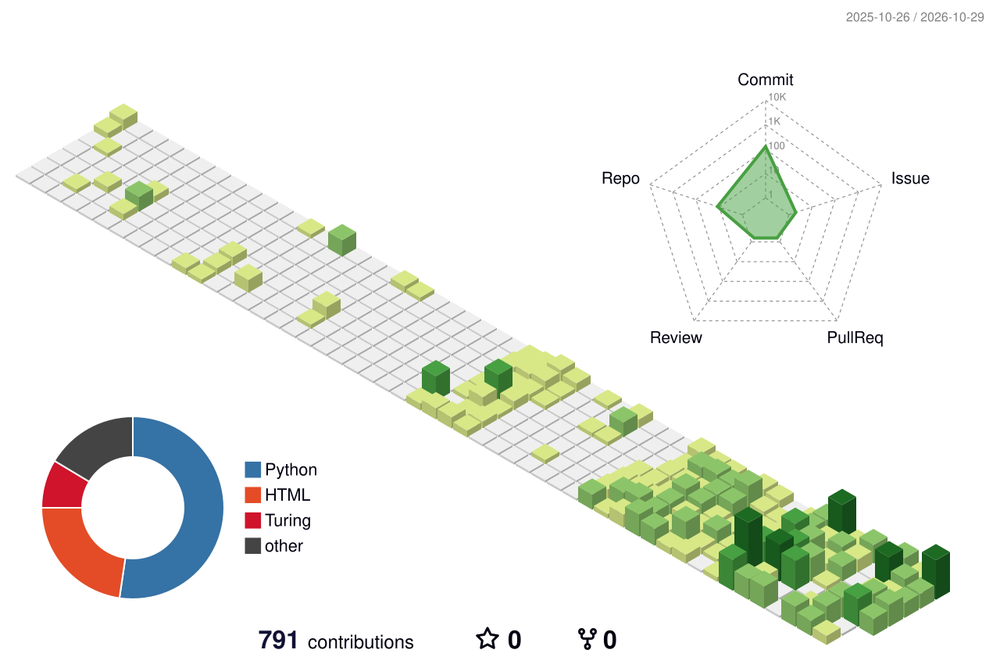

<h1 align="center">Dongxu Liu</h1>

  Undergraduate in Artificial Intelligence, Jilin University 
  Optimization &middot; Spiking Neural Networks &middot; Model Compression &middot; LLM Agents &middot; Embodied AI

  <a href="https://ldx825.github.io/liudongxu825.github.io/">Homepage</a> &nbsp;&middot;&nbsp;
  <a href="https://scholar.google.com/citations?user=053eRGQAAAAJ&hl=en">Google Scholar</a> &nbsp;&middot;&nbsp;
  <a href="mailto:liudx9924@mails.jlu.edu.cn">Email</a>

---

**Now.** Research intern at AutoLab / Awaken Robotics, Shanghai Jiao Tong University, working on VLA and World Action Models with [Prof. Zhipeng Zhang](https://zhipengzhang.cn/).

**Selected papers.**

- *Towards Nonlinear Sparse AUC Maximization via Compositional Stochastic Hard Thresholding* &mdash; AAAI 2026
- *Zeroth-Order Stochastic Compositional Gradient Descent: Towards Black-Box Sparse AUC Maximization* &mdash; AISTATS 2026
- *Rethinking Gradient Approximation in Quantization: A Zeroth-Order Expectation Perspective* &mdash; NeurIPS 2026

[All publications and projects &rarr;](https://ldx825.github.io/liudongxu825.github.io/#publications)

**Experience.**

| | |
|---|---|
| Shanghai Jiao Tong University, AutoLab / Awaken Robotics | Mar 2026 &ndash; Present |
| Jilin University, College of Artificial Intelligence | Jul 2026 &ndash; Oct 2026 |
| Jilin University, College of Artificial Intelligence | Jan 2025 &ndash; Mar 2026 |

**Service.** Reviewer for ICLR 2027 and ICASSP 2027.

---

  

